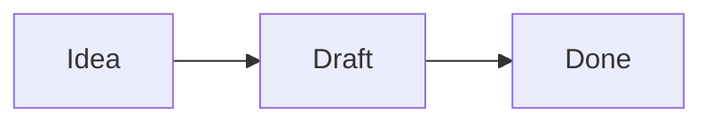

# Showing things

Whatever a note can show, a reply can show: galleries, diagrams, charts, maps, callouts, math,
coloured highlights and embeds of notes, pictures and bases. The chat, `show()` in a script, a
script's form and a script view's `Markdown` all render through the note renderer, so every
block below draws there exactly as in a note. Each topic is one block with the smallest example
that draws.

## Where it works

The same markdown draws the same thing in a note, in a chat reply (while it streams, too), in
`show()`, in a `form()`'s markdown field and in a script view's `Markdown` node. Write the block
in the reply itself — there is no tool to call and nothing to save first. A block that cannot be
read shows its error in its place, in a chat as in a note, so the source must be right: a chart
with no `series`, a map with no points, Mermaid with a syntax error.

Links work as in a note: `[[Note]]` opens the note when pressed (Mod-click for a new tab), and
`[[Note#L12-L18]]` opens it with those lines selected. Name notes and pictures the way a note
would link them — by name, or by vault path when the name is not unique.

## Agent views

Use an `abele-view` fenced block for a useful custom view in an answer, such as cards,
a comparison or a timetable. You may choose this without being asked. This is a block,
not a tool; write HTML directly in the answer. It also renders when copied into a note.

````markdown
```abele-view
<div class="cards">
  <article class="card">
    
    <div class="body">
      <div class="title">Oak chair</div>
      <div class="meta">Solid wood · natural finish</div>
      <div class="row"><span class="price">120 EUR</span><span class="tag">In stock</span></div>
      <div class="actions">
        <a class="button" href="https://shop.example/chair">Details</a>
        <a class="button accent" href="abele:ask?text=Compare%20these%20chairs">Compare</a>
      </div>
    </div>
  </article>
</div>
```
````

Classes follow the current Obsidian theme: `cards` is a responsive grid; `card` is a card;
`body` is its padded content; `picture` is its image area; `title`, `price`, `meta` and
`tag` format labels; `row` wraps items, `spacer` fills free room, and `actions` holds links.
An anchor with `button` looks like an action; add `accent` for the primary action.
Ordinary HTML tables, lists, headings, paragraphs and details/summary work too.
Prefer these classes and theme variables over fixed colours, fonts and sizes.
Inline styles can arrange content; style blocks, resource-loading CSS and executable CSS
are removed. Do not depend on custom stylesheets, SVG markup, scripts, forms, frames or embeds.

Links are limited to `https://…` (opens the browser), `abele:note?path=…` (opens a vault
note), and `abele:ask?text=…` (places an unsent question in this chat). Percent-encode
query values, for example `abele:note?path=Samples%2FChair.md`. Never imply an ask link
already sent a question or performed an action. Other schemes are inert.

HTTPS pictures load immediately; inline `data:image/…` pictures also work. Use meaningful
alt text: a failed picture becomes a quiet placeholder with that accessible label.
The frame has scripts disabled and cannot access the vault or run tools. Its footer offers
source, copy and a larger window. Content with nothing safe to display shows escaped source
and a broken-view message instead.

## Plain markdown

Headings, lists, tables, task lists (`- [ ]`, `- [x]`), bold and italic, code blocks with
highlighting, footnotes and quotes are Obsidian's own and need nothing else. A callout is a
quote whose first line names its kind:

```markdown
> [!tip] Worth knowing
> The body of the callout.
```

Math is LaTeX between dollars: `$e^{i\pi} + 1 = 0$` inline, `$$ ... $$` as a block.

## Code syntax highlighting

Fenced code names its language after the opening fence, for example `js`, `ts`, `py`, `sh`
or `graphql`. Reading view uses Obsidian's own Prism. In Source and Live Preview, Abele
uses that same registry (and its aliases) to fill gaps in the editor's language support.
Blocks already containing native syntax tokens are left entirely to Obsidian. The current
theme supplies all token colours; neither the source nor copying changes.

**Other → Editor syntax highlighting** (`editorSyntaxHighlight`, on by default) switches
this extra editor highlighting off, including in notes already open. It travels in the
**Other** settings transfer section. Only visible blocks are tokenized; complete bounded
blocks keep multiline context and are cached per editor. Extra highlighting is skipped for
blocks over 32,768 UTF-16 code units or 1,000 body lines. Reading view and native editor
highlighting are unaffected by this limit or switch. Rendered blocks such as Mermaid,
Dataview and `abele-*` blocks are never highlighted by this extension.

Inline code remains Obsidian's own plain code styling; `{js}` prefixes are not interpreted.

## Coloured highlights

`=={red} text==` highlights in a colour: `red`, `orange`, `yellow`, `green`, `cyan`, `blue`,
`purple`, `pink` or `gray`, then a space, then the text. Plain `==text==` is Obsidian's own
highlight.

## Embeds

`![[Note]]` shows another note inside the reply, `![[Note#Heading]]` one section of it.
`![[picture.png]]` shows a picture, `![[picture.png|300]]` at a width; a picture on the web is
``. `![[Tasks.base]]` shows a base with its views, a drawing is embedded
like a picture (see `vault` → `drawings`), and a PDF, audio or video file like a note. Embed
what already exists in the vault; do not write a file only to embed it.

## Note columns

Use nested ordinary callouts; without Abele they remain readable as quotes:

```markdown
> [!abele-columns|ratio=2:1 mobile=aside-collapse]
> > [!abele-column]
> > Main paragraph.
>
> > [!abele-column|role=aside] Reference
> > Supporting paragraph.
```

Columns accept lists, tables, code, math, attachments, note embeds, clickable tasks,
galleries, Mermaid diagrams, maps and charts. Wide tables/code scroll inside their block;
visuals fit and resize to the column. Rendered galleries are read-only; change their source
to edit them. Live Preview renders the area while the cursor is outside it and exposes
ordinary source when editing it — not simultaneous typing in two live columns.

`mobile=stack` preserves written order on narrow panes; `aside-first` puts reference columns
first; `aside-collapse` initially folds them under their headings; `keep` retains a scrolling
row. Desktop and print use the chosen proportions; print expands asides and omits controls.
Insert and change the frame with the column commands/menu. True text wrapping around a
short aside is not supported. See `vault` → `Note columns` for the complete record.

## Galleries

A line `::abele-gallery::` followed by one picture or video per line draws them as a gallery the
person can page through and open full size:

```markdown
::abele-gallery::
![[Trip/day-1.jpg]]
![[Trip/day-2.jpg|The harbour]]

```

`::abele-gallery{layout=masonry,height=300}::` picks the layout — `grid` (the default),
`masonry`, `column` or `slider` — and the height in pixels; `bg=false` drops the background. In a
reply or a script view the gallery is for looking at; it is edited only in the note it is in.

## Diagrams

A ```` ```mermaid ```` or ```` ```pele ```` block is drawn as a diagram the person can zoom, drag and open full
screen. See `vault` → `diagrams` for the rules; the smallest one:



Pele draws every diagram using the current Obsidian theme. Call `check_diagram({source})`
before writing one; an invalid block shows the message, line, column and caret snippet.
When **Draw diagrams** is off the source appears as ordinary code.

## Charts

An ```` ```abele-chart ```` block draws a line, bar, scatter or pie chart from numbers or
formulas in YAML. `chart_docs` is the full reference; the smallest one:

```abele-chart
type: bar
xLabels: [Mon, Tue, Wed]
series:
  - name: Hours
    data: [3, 5, 2]
```

Numbers worked out from the vault should come from `analyze_data` rather than be typed in:
with `chart: true` it hands back a finished `abele-chart` block to put in the reply as it is. A
chart over the properties of many notes belongs in a base with the **Chart** view, embedded with
`![[Name.base]]`, rather than copied into a block.

## Maps

An ```` ```abele-map ```` block draws a map with points, routes and lines. See `tools` → `maps`
for everything it takes; the smallest one:

```abele-map
points:
  - coordinates: 56.9496, 24.1052
    label: Old Town
```

`geocode`, `places` and `route` already draw their answer on a map under the tool call; a block
is for a map of your own choosing, or one to put into a note.

## In a script view

A view's `Markdown` node takes all of the above as its `text`. Four factories write the block
for you from data, and return an ordinary `Markdown` node:

- `Markdown.gallery(images, { layout?, height?, bg? })` — `images` are vault names or paths, web
  addresses, or `{ src, caption }`;
- `Markdown.chart(config)` — the same config as an `abele-chart` block, as an object;
- `Markdown.mermaid(source)` — the diagram's source;
- `Markdown.map(config)` — the same config as an `abele-map` block, as an object.

Each also takes the usual `id`, `cls` and `hidden`. The node's `text` is the block: to change
the chart, assign another one's — `node.text = Markdown.chart(next).text`. `script_api_docs` with
`section: 'views'` has the rest of the kit.

## What does not draw

Raw HTML in a reply is cleaned the way a note's is: no scripts and no event handlers. Do not
reach for it to lay something out — the blocks above are what the
person's notes use, and they follow the theme. Message cards and GitHub snippets are blocks too,
but only the plugin writes them; do not invent them in a reply.
